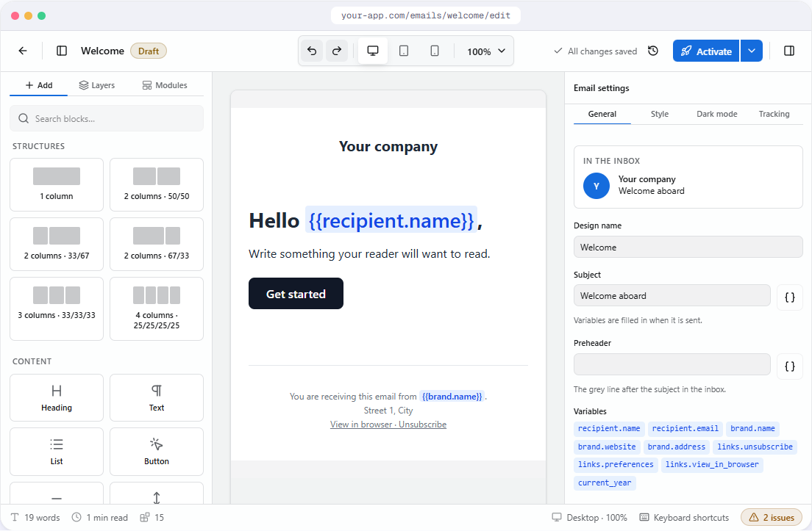

# Builderset

[](https://github.com/builderset/builderset/actions/workflows/ci.yml)
[](https://www.npmjs.com/package/@builderset/email)
[](LICENSE)

**Let your users design emails, articles, forms, cards and popups — inside your own app.**

Builderset is the editor, the renderer and the checker, as React components and a
server library. You bring the theme, the language and the database.

[](https://builderset.vercel.app)

- **One engine for every kind of content.** Emails, articles, forms, member cards and
  popups, on the same workspace: drag and drop, undo, an inspector, saved sections,
  several languages in one document — and, for a card or a popup, a free canvas
  where each element sits at its own place.
- **Takes your theme and your language.** A small set of CSS variables, or your
  shadcn tokens in one import; light and dark. The editor speaks English, Albanian
  and German.
- **Your database, your API.** No iframe, no hosted account. Documents are typed
  JSON you store where you like; your server checks and renders them, in Node or
  in Python.

**[Website](https://builderset.vercel.app)** ·
**[Documentation](https://docs-builderset.vercel.app/docs)** ·
**[Playground](https://docs-builderset.vercel.app/playground)**

> **Status: 0.5.2, on GitHub Packages.** The packages are used in production, but
> they are not on npm yet and the API may change before 1.0. Installing needs a
> token until then — see [Install](https://docs-builderset.vercel.app/docs/install).

## Packages

| Package                                   | What                                                                                                                                                                                            |
| ----------------------------------------- | ----------------------------------------------------------------------------------------------------------------------------------------------------------------------------------------------- |
| [`@builderset/engine`](packages/engine)   | The node tree, operations with undo, the host contract, the generic editor and its UI kit                                                                                                       |
| [`@builderset/article`](packages/article) | Articles: elements, renderer for the web, editor, schema and contract fixtures                                                                                                                  |
| [`@builderset/email`](packages/email)     | Emails: elements, renderer to email HTML and text, editor, schema and golden files                                                                                                              |
| [`@builderset/form`](packages/form)       | Forms: fields with checks and logic, the working form for a page, editor, `validateAnswers` for the server, schema and fixtures                                                                 |
| [`@builderset/card`](packages/card)       | Cards: membership, ID, bank and business cards in millimetres, front and back, member data, a print-ready sheet, print checks, schema and fixtures                                              |
| [`@builderset/popup`](packages/popup)     | Popups: modals, slide-ins, bars, drawers, display rules and motion, the working popup for a site, `shouldShow` and `validateSubmission`, schema and fixtures                                    |
| [`builderset`](packages/builderset)       | Every kit in one install, under `builderset/email/…`, `builderset/article/…`, `builderset/form/…`, `builderset/card/…`, `builderset/popup/…`, one stylesheet for all                            |
| [`builderset` (Python)](python)           | The server side in Python, the same answers as the TypeScript: `check_*` for every kit, `validate_answers`, `validate_submission`, `should_show`, `fill_card`, and `render_email` byte for byte |

Every kit has the same entries: `core` (the document, no React, runs on a
server), `render`, `editor`, `host` and `locales/*`. What a backend must store,
check and render is in
[packages/engine/src/host/BACKEND.md](packages/engine/src/host/BACKEND.md).

Targets: React 19; Node 20 or newer for `core`, `render` and `host`; ES modules
only; current browsers.

## Working on it

Node 24 (`.nvmrc`) and pnpm 11 (`corepack enable`).

```bash
pnpm install
pnpm lint
pnpm typecheck
pnpm test
pnpm format:check
pnpm build
pnpm check:packages      # what was built: use client, imports, manifests, types
```

[CONTRIBUTING.md](CONTRIBUTING.md) has the rules for a change.
